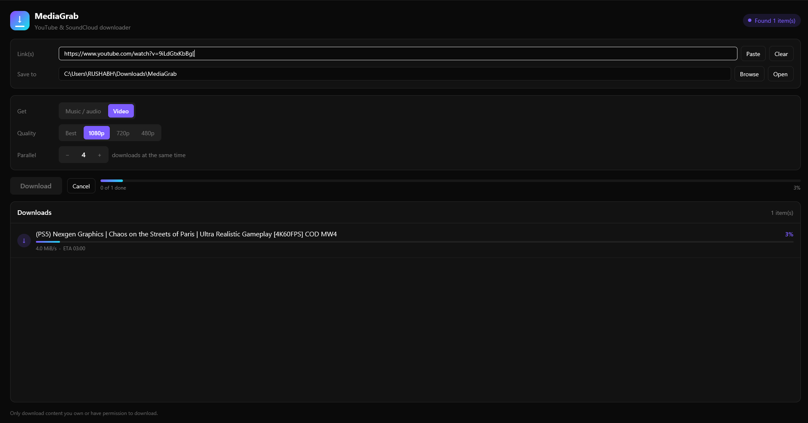

<p align="center">
  
</p>

<h1 align="center">MediaGrab</h1>

<p align="center">
  <b>Grab your own videos, music and audio in seconds.</b><br>
  A fast, modern desktop app for creators, built with Rust + <a href="https://www.gpui.rs/">GPUI</a>.
</p>

<p align="center">
  
</p>

---

## Who is it for?

MediaGrab is made for **creators** who need a clean copy of their own work, or of content they are allowed to use:

* **YouTubers & video editors:** pull your own uploads back as `.mp4` (up to 1080p or best quality) for re-edits, archives, shorts or backups.
* **Musicians & producers:** save your own YouTube / SoundCloud tracks as **MP3, M4A, Opus or FLAC**, with the **title tagged and the cover art embedded**.
* **Podcasters & streamers:** download your episodes, VODs or intros as audio for editing.
* **Channel managers & agencies:** back up a client's whole playlist or SoundCloud set (with their permission) in one go.
* **Anyone using royalty-free / Creative Commons media:** collect music and clips you are licensed to use for your projects.

> **Only download content you own or have permission to download.** Downloading from YouTube may
> violate YouTube's Terms of Service, and copyright applies to what you download. You are responsible
> for how you use this tool.

---

## What you can do

| You want to... | MediaGrab does |
|---|---|
| Download a video | Saves it as `.mp4`, best quality up to the height you choose (Best / 1080p / 720p / 480p) |
| Download music or audio | Converts to **MP3, M4A, Opus or FLAC** at best quality |
| Keep your music organised | Writes the **title (and other metadata) into the tags** and **embeds the thumbnail as cover art** |
| Also need the artwork | Tick **Also save cover .jpg** to get `<title>.jpg` next to the file |
| Download a whole playlist or SoundCloud set | Paste one link; every entry is downloaded into a folder named after the playlist |
| Save time | Downloads **several items in parallel** (1-12 at once) |
| Stay in control | Live progress, speed and ETA per item, plus a **Cancel** button that stops everything |

Other niceties: paste / clear buttons, a native **Browse** folder picker, an **Open** folder button, press **Enter** to start, and one failed item never stops the rest of the playlist.

---

## Quick start (for creators)

1. **Install the tools** (one time, see [Prerequisites](#prerequisites)): Rust, yt-dlp, ffmpeg and Deno.
2. **Run the app:**
   ```bash
   cargo run -p mediagrab-app --release
   ```
   The first build compiles GPUI, so expect a long compile. After that it starts quickly.
3. **Paste** your link(s). Several links can be separated with spaces. A playlist link downloads every entry.
4. Choose **Music / audio** or **Video**, then the format or quality.
5. Pick where to **Save to** (default: `Downloads/MediaGrab`) and press **Download**.

That's it. Rows show queued / % / speed / ETA / done / failed.

---

## Prerequisites

1. **Rust** (latest stable): <https://rustup.rs>
2. **yt-dlp** (keep it updated: `yt-dlp -U`)
   * Windows: `winget install yt-dlp`  * macOS: `brew install yt-dlp`  * Linux: `pipx install yt-dlp`
3. **ffmpeg** (needed for conversion, merging and cover art)
   * Windows: `winget install ffmpeg`  * macOS: `brew install ffmpeg`  * Linux: `sudo apt install ffmpeg`
4. **A JavaScript runtime for YouTube (Deno recommended).** Recent yt-dlp versions need one to solve
   YouTube's challenges. Install Deno from <https://docs.deno.com/runtime/getting_started/installation/>.
   To use Node instead, set `MEDIAGRAB_YTDLP_ARGS="--js-runtimes node"`. If you installed yt-dlp
   through pip, also run `pip install yt-dlp-ejs`.
5. **Platform libraries for GPUI** (GUI only, not needed for the CLI): Windows needs Visual Studio
   Build Tools with the Windows SDK; macOS needs Xcode command line tools; Linux needs the usual
   graphics/windowing dev packages (Wayland/X11, xkbcommon, fontconfig, Vulkan).

Check your tools:

```bash
yt-dlp --version && ffmpeg -version | head -1 && cargo --version
```

---

## Behaviour details

* **Audio:** best audio stream converted to your chosen format; title (plus artist and other metadata) written to tags; thumbnail converted to JPG and **embedded as cover art**.
* **Video:** best video + audio up to your chosen height, preferring mp4/m4a streams, merged to `.mp4`. The title is in the filename and metadata. **No thumbnail** is downloaded or embedded.
* **Playlists:** items go into a sub-folder named after the playlist. A watch link that also contains `&list=` downloads only that one video; paste the `.../playlist?list=` link for the whole list.
* **Parallel:** the number of simultaneous yt-dlp processes (1-12). Start with 3-4; too many can trigger rate limiting.
* **Video progress** can run 0-100% twice (video stream, then audio stream) before merging.
* **Existing files** are skipped by yt-dlp ("already downloaded").
* **Failures are per item:** one private or deleted entry does not stop the playlist.

---

## Command line (optional)

The engine also works without the GUI, which is handy for scripts and automation:

```bash
# one SoundCloud track
cargo run -p mediagrab-core --bin mediagrab-cli -- --audio --out ./music "https://soundcloud.com/ARTIST/TRACK"

# a YouTube playlist as MP3, 4 at a time
cargo run -p mediagrab-core --bin mediagrab-cli -- --audio --format mp3 --parallel 4 --out ./music \
  "https://www.youtube.com/playlist?list=PLAYLIST_ID"

# a single video, max 720p
cargo run -p mediagrab-core --bin mediagrab-cli -- --video --height 720 --out ./videos "https://www.youtube.com/watch?v=VIDEO_ID"
```

Other flags: `--format mp3|m4a|opus|flac`, `--height N|best`, `--cover-file`,
`--extra "--js-runtimes node"`, `--ytdlp /path/to/yt-dlp`.

---

## Troubleshooting

| Symptom | Fix |
|---|---|
| `could not start 'yt-dlp': not found` | Install yt-dlp and make sure it is on `PATH` (restart the terminal/app). |
| YouTube errors like "video not available", missing formats, HTTP 403 | Run `yt-dlp -U`; install **Deno**; if you use Node: `MEDIAGRAB_YTDLP_ARGS="--js-runtimes node"`. |
| "Sign in to confirm you're not a bot" | Use your browser's cookies: `MEDIAGRAB_YTDLP_ARGS="--cookies-from-browser firefox"` (or chrome/edge). |
| Audio is not converted / no cover art | ffmpeg is missing: install it and check `ffmpeg -version`. |
| SoundCloud track "not available" / only a 30s preview | Some tracks are geo-restricted or Go+-only; yt-dlp can only fetch what the site serves you. |
| GUI build errors | Keep `gpui` and `gpui-component` versions as a pair, update Rust, and install your OS prerequisites for GPUI. |

Set the variable before launching, e.g. PowerShell:
`$env:MEDIAGRAB_YTDLP_ARGS="--js-runtimes node"; cargo run -p mediagrab-app --release`
Linux/macOS: `MEDIAGRAB_YTDLP_ARGS="--js-runtimes node" cargo run -p mediagrab-app --release`

---

## How it is built

Rust workspace with a UI-free engine and a thin GPUI front end:

```
crates/
  mediagrab-core/        <- the engine. No UI code. Testable from a terminal.
    types.rs             plain data: Options, Item, ItemState, Event
    parse.rs             pure functions: parse yt-dlp output          (unit tested)
    resolve.rs           link -> list of items (playlist expansion)
    download.rs          ONE yt-dlp process for ONE item, progress, cancel
    engine.rs            queue + Semaphore (parallelism) + Event channel + cancel
    bin/cli.rs           command-line front end
  mediagrab-app/         <- GPUI front end (window, buttons, list). Just applies Events.
    assets/              logo (svg / png / ico)
    build.rs             embeds the icon into the Windows .exe
demo/                    screenshots
scripts/local_test.sh    offline end-to-end smoke test (no internet needed)
```

```
 pasted link(s) --> resolve --> [Item, Item, Item ...]
                                     |  one tokio task per item
                                     v
                         Semaphore(parallel = N permits)
                           |      |      |      (N yt-dlp processes at once)
                           v      v      v
                        Events (progress, state) --one channel--> GPUI view --> screen
```

| Need | Choice | Why |
|---|---|---|
| YouTube + SoundCloud extraction | **`yt-dlp` binary**, driven with `tokio::process` | YouTube changes constantly; yt-dlp is updated within days, and the same flags cover SoundCloud. |
| Conversion, merging, cover art | **`ffmpeg`** (called by yt-dlp) | Needed for mp3/m4a/flac/opus, merging video+audio into mp4 and embedding thumbnails. |
| Parallelism | **`tokio`** (`JoinSet`, `Semaphore`, `mpsc`, `watch`) | One task per item, a semaphore caps concurrency, channels carry events and cancel. |
| Parsing yt-dlp JSON | **`serde_json`** | The only dependency besides tokio in the core. |
| UI | **`gpui`** + **`gpui-component`** | GPUI has no built-in inputs or buttons; gpui-component supplies `Input` and `Root`. |
| Folder picker | **`rfd`** | Native "Browse" dialog. |

Run the tests with `cargo test -p mediagrab-core`, or the offline end-to-end check with
`./scripts/local_test.sh` (Linux/macOS/WSL; needs yt-dlp, ffmpeg, python3).

---

## Roadmap

* Show thumbnails in the download list
* Drag-and-drop links and a clipboard watcher
* Per-item retry button, pause / resume
* Auto-update yt-dlp on start, or auto-fetch yt-dlp/ffmpeg binaries
* Ready-made installers for Windows, macOS and Linux

---

## Disclaimer

MediaGrab is a front end for [yt-dlp](https://github.com/yt-dlp/yt-dlp) and [ffmpeg](https://ffmpeg.org/).
It is intended for downloading **your own content** or content you have **explicit permission or a
licence** to use. Respect the terms of service of each platform and the rights of other creators.